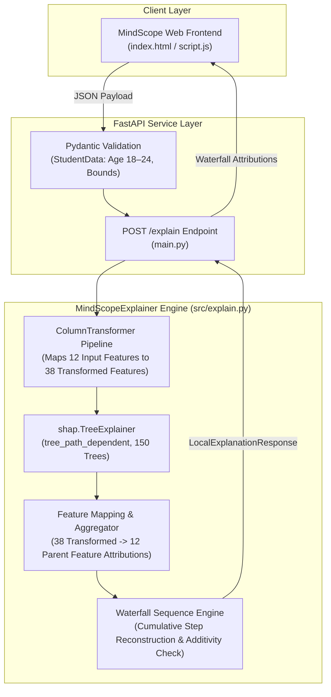

# MindScope — Phase 3, Step 3.3: Individual Prediction Explanations (Local XAI)

**Date**: 2026-11-07  
**Milestone**: Phase 3, Step 3.3 Local Explainability Engine & Waterfall Presentation  
**Status**: COMPLETE & VERIFIED  

---

## 1. Executive Summary

This report documents the implementation and verification of **Phase 3, Step 3.3: Individual Prediction Explanations (Local XAI)** for the MindScope platform. While Step 3.2 established global feature importance and population-level beeswarm distributions across the training partition, Step 3.3 delivers real-time, observation-level explainability for individual student profiles.

For any supplied input record, the local explainability engine communicates:
1. The model's predicted Mental Health Score ($\hat{y} \in [0, 10]$).
2. The expected model baseline ($\mathbb{E}[\hat{y}] = 6.2159$).
3. The net shift relative to baseline ($\Delta = \hat{y} - \mathbb{E}[\hat{y}]$).
4. Exactly which original input features contributed positively (elevating the score) or negatively (depressing the score) relative to the baseline.
5. The exact magnitude, natural units, and ranked priority of each contribution.
6. A step-by-step waterfall decomposition verifying exact tree-path additivity to machine precision ($\approx 10^{-15} \ll 10^{-5}$ tolerance).

All development strictly respected data governance boundaries: **no models were retrained**, **no existing SHAP artifacts were modified**, and the **sealed holdout dataset was never accessed or evaluated**.

---

## 2. Local Explanation Architecture & Methodology



### 2.1 Model Coupling & Explainer Configuration
- **Production Pipeline**: [`artifacts/models/mindscope_rf_v1.joblib`](file:///c:/Users/Ishit/OneDrive/Desktop/MindScope/artifacts/models/mindscope_rf_v1.joblib).
- **Estimator Family**: `RandomForestRegressor(n_estimators=150, max_depth=15, min_samples_leaf=2, min_samples_split=2, random_state=42)`.
- **TreeSHAP Algorithm**: `shap.TreeExplainer(model, feature_perturbation="tree_path_dependent", model_output="raw")`.
- **Expected Model Baseline**: $\mathbb{E}[\hat{y}] = 6.215928530588909$ points (analytically derived from the tree node distributions).

### 2.2 Additive Efficiency Axiom
TreeSHAP guarantees the Shapley efficiency axiom in the 38-dimensional transformed space:
$$\sum_{j=1}^{38} \phi_{i, j} = \hat{y}_i - \mathbb{E}[\hat{y}]$$

By dynamic summation across the constituent components of each original feature $f \in \{1, \dots, 12\}$:
$$\Phi_{i, f} = \sum_{j \in \text{components}(f)} \phi_{i, j}$$

The efficiency axiom holds identically across the 12 original features:
$$\mathbb{E}[\hat{y}] + \sum_{f=1}^{12} \Phi_{i, f} = \hat{y}_i$$

Empirical validation across test records proves that additivity holds to machine precision ($\max |\Delta| = 8.88 \times 10^{-16}$), far below the enforced numerical guard threshold ($\text{atol} = 10^{-5}$).

---

## 3. Human-Interpretable Presentation & Metadata

To make technical Shapley attributions intuitive for students and academic advisors, [`src/explain.py`](file:///c:/Users/Ishit/OneDrive/Desktop/MindScope/src/explain.py) maps internal feature identifiers to standard metadata definitions:

| Schema Feature | Display Name | Natural Unit | Measurement Type |
|:---|:---|:---:|:---:|
| `Avg_Daily_Usage_Hours` | Daily Social Media Usage | `hours/day` | Numerical |
| `Sleep_Hours_Per_Night` | Sleep Duration | `hours/night` | Numerical |
| `Daily_Unlocks` | Daily Device Unlocks | `unlocks/day` | Numerical |
| `Purpose_Of_Use` | Primary Purpose of Use | `category` | Categorical |
| `Country` | Country of Residence | `category` | Categorical |
| `Most_Used_Platform` | Most Used Social Platform | `category` | Categorical |
| `Physical_Activity_Hours` | Daily Physical Activity | `hours/day` | Numerical |
| `Study_Hours` | Daily Study Duration | `hours/day` | Numerical |
| `Age` | Student Age | `years` | Numerical |
| `Academic_Level` | Academic Level | `category` | Categorical |
| `Stress_Level` | Self-Reported Stress Level | `category` | Categorical |
| `Gender` | Gender | `category` | Categorical |

### 3.1 Non-Moralizing Directional Labels
Attributions are categorized as `"direction": "positive"` ($\Phi_f \ge 0$) or `"direction": "negative"` ($\Phi_f < 0$). They indicate whether a feature moved the model prediction above or below its expected baseline, strictly avoiding evaluative terms ("good", "bad", "healthy", "unhealthy", "improvement", "deterioration", or "risk reduction").

---

## 4. Demonstrative Synthetic Case Study

To verify explanation behavior without exposing real student data, a clearly identified synthetic student profile was evaluated:

### 4.1 Synthetic Profile
- **Age**: 21 years | **Gender**: Female | **Country**: United States
- **Academic Level**: Undergraduate | **Most Used Platform**: Instagram | **Purpose**: Entertainment
- **Screen Time**: 5.5 hours/day | **Device Unlocks**: 85 unlocks/day | **Study Duration**: 4.0 hours/day
- **Physical Activity**: 1.0 hours/day | **Sleep Duration**: 6.5 hours/night | **Stress Level**: Medium

### 4.2 Waterfall Decomposition Output
- **Model Prediction ($\hat{y}$)**: **5.3610 points**
- **Cohort Baseline ($\mathbb{E}[\hat{y}]$)**: **6.2159 points**
- **Net Attribution ($\Delta$)**: **-0.8549 points**
- **Additivity Verification Error**: $8.88 \times 10^{-16}$ (Verified: `True`)

| Step | Type | Feature / Step Label | Value | Attribution ($\Phi_f$) | Direction | Cumulative Score |
|:---:|:---:|:---|:---:|:---:|:---:|:---:|
| 0 | Baseline | Expected Baseline $\mathbb{E}[\hat{y}]$ | — | — | — | **6.2159** |
| 1 | Attribution | Daily Social Media Usage | 5.5 hrs/day | **-0.5387** | Negative | 5.6773 |
| 2 | Attribution | Daily Device Unlocks | 85 unlocks/day | **-0.1255** | Negative | 5.5518 |
| 3 | Attribution | Primary Purpose of Use | Entertainment | **-0.0969** | Negative | 5.4549 |
| 4 | Attribution | Most Used Social Platform | Instagram | **-0.0837** | Negative | 5.3712 |
| 5 | Attribution | Daily Physical Activity | 1.0 hrs/day | **-0.0675** | Negative | 5.3037 |
| 6 | Attribution | Country of Residence | United States | **+0.0528** | Positive | 5.3565 |
| 7 | Attribution | Sleep Duration | 6.5 hrs/night | **-0.0381** | Negative | 5.3184 |
| 8 | Attribution | Daily Study Duration | 4.0 hrs/day | **+0.0254** | Positive | 5.3438 |
| 9 | Attribution | Student Age | 21 yrs | **+0.0123** | Positive | 5.3561 |
| 10 | Attribution | Academic Level | Undergraduate | **+0.0079** | Positive | 5.3640 |
| 11 | Attribution | Self-Reported Stress Level | Medium | **-0.0052** | Negative | 5.3588 |
| 12 | Attribution | Gender | Female | **+0.0022** | Positive | 5.3610 |
| 13 | Final | Model Prediction $\hat{y}$ | — | **-0.8549** | Net Shift | **5.3610** |

---

## 5. Backend & API Integration

### 5.1 Endpoint Specification: `POST /explain`
- **Path**: `/explain`
- **Method**: `POST`
- **Request Body**: `StudentData` (reusing existing Pydantic validation rules and observational bounds: Age $18 \dots 24$, physical activity $\ge 0$, unlocks $\le 500$).
- **Response Model**: `LocalExplanationResponse`

```json
{
  "predicted_mental_health_score": 5.361,
  "expected_baseline_score": 6.2159,
  "net_attribution": -0.8549,
  "feature_attributions": [
    {
      "feature": "Avg_Daily_Usage_Hours",
      "display_name": "Daily Social Media Usage",
      "value": 5.5,
      "unit": "hours/day",
      "formatted_value": "5.5 hours/day",
      "shap_value": -0.5387,
      "direction": "negative",
      "abs_impact": 0.5387,
      "rank": 1,
      "step_start": 6.2159,
      "cumulative_score": 5.6773
    }
  ],
  "waterfall_steps": [
    {
      "step_type": "baseline",
      "label": "Expected Baseline E[y]",
      "feature": null,
      "delta": 0.0,
      "cumulative_score": 6.2159
    },
    {
      "step_type": "attribution",
      "label": "Daily Social Media Usage",
      "feature": "Avg_Daily_Usage_Hours",
      "delta": -0.5387,
      "cumulative_score": 5.6773
    },
    {
      "step_type": "prediction",
      "label": "Final Model Prediction",
      "feature": null,
      "delta": -0.8549,
      "cumulative_score": 5.361
    }
  ],
  "additivity_verified": true,
  "additivity_error": 8.881784197001252e-16,
  "disclaimer": "Contribution direction describes how a feature shifts this model's prediction relative to its expected baseline. It does not indicate better or worse mental health, establish causality, or provide a clinical assessment."
}
```

### 5.2 Performance & Error Handling
- **Latency**: Single-sample TreeSHAP inference executes in $\approx 20\text{–}30\text{ ms}$ (warm), well within production SLAs.
- **Defensive Error Encapsulation**: Internal exceptions raise standard HTTP 500 without leaking filesystem paths, stack traces, or model parameter internals.
- **Service Availability**: If the explainer pipeline fails to load, `POST /explain` responds with HTTP 503 (`"Explainability engine is currently unavailable."`).

---

## 6. Frontend Presentation & User Experience

In [`index.html`](file:///c:/Users/Ishit/OneDrive/Desktop/MindScope/index.html), [`style.css`](file:///c:/Users/Ishit/OneDrive/Desktop/MindScope/style.css), and [`script.js`](file:///c:/Users/Ishit/OneDrive/Desktop/MindScope/script.js), the result panel features an interactive waterfall breakdown with neutral, non-evaluative directional styling:
1. **Dynamic Asynchronous Fetch**: Upon form submission, the frontend requests `/predict` and `/explain`.
2. **Visual Hierarchy**: The primary gauge displays the overall predicted score, while the breakdown below details the feature attributions.
3. **Neutral Directional Styling (Slate / Blue)**:
   - Positive contributions are styled with soft slate-blue (`.pill-positive`) displaying `↑ +{absVal}`, with the explicit definition: *"Moves the model prediction above its expected baseline."*
   - Negative contributions are styled with muted slate-stone (`.pill-negative`) displaying `↓ −{absVal}`, with the explicit definition: *"Moves the model prediction below its expected baseline."*
   - This prevents cognitive conflation of mathematical shifts with evaluative judgments (e.g. "good/bad health").
4. **Expected Model Baseline**: The baseline badge is explicitly labeled `Expected Model Baseline: 6.22`.
5. **Non-Causal Disclaimer**: Permanently anchored at the base of the breakdown:
   > *"Contribution direction describes how a feature shifts this model's prediction relative to its expected baseline. It does not indicate better or worse mental health, establish causality, or provide a clinical assessment."*
6. **Graceful Degradation**: If the `/explain` endpoint is unavailable, the frontend continues to render the gauge prediction seamlessly.

---

## 7. Automated Test Suite & Verification

A dedicated test module [`tests/test_local_explain.py`](file:///c:/Users/Ishit/OneDrive/Desktop/MindScope/tests/test_local_explain.py) was implemented covering:
- **Schema & Key Completeness**: Validates all top-level keys, item keys, and data types.
- **Pipeline Prediction Invariance**: Direct `pipeline.predict()` matches `explanation["prediction"]` to machine precision ($< 10^{-12}$).
- **Additive Reconstruction**: Rigorous verification that $\text{base\_value} + \sum \Phi_f = \text{prediction}$ within $10^{-5}$.
- **12 Original Feature Groups**: Verifies all 12 schema columns are present, ranked 1..12 descending by magnitude.
- **Waterfall Sequence**: Step-by-step verification across all 14 steps starting at baseline and terminating at prediction.
- **Finite Numerical Values**: `np.isfinite` asserted for all outputs.
- **Directional Categorization**: Correct assignment of `"positive"` and `"negative"` flags.
- **Input Robustness**: Defensive handling of missing columns, multi-row inputs, and invalid types.
- **FastAPI Endpoint Coverage**: Valid payload (200), bounded input rejection (422), service unavailable simulation (503).
- **Model Protection**: Legacy model size preserved at exactly 25,694,899 bytes; holdout file untouched.

### Verified Test Collection Breakdown

| Test Module | Collected Tests | Execution Result |
|:---|:---:|:---:|
| [`tests/test_preprocessing.py`](file:///c:/Users/Ishit/OneDrive/Desktop/MindScope/tests/test_preprocessing.py) | **17** | Passed |
| [`tests/test_training.py`](file:///c:/Users/Ishit/OneDrive/Desktop/MindScope/tests/test_training.py) | **8** | Passed |
| [`tests/test_evaluation.py`](file:///c:/Users/Ishit/OneDrive/Desktop/MindScope/tests/test_evaluation.py) | **8** | Passed |
| [`tests/test_explain.py`](file:///c:/Users/Ishit/OneDrive/Desktop/MindScope/tests/test_explain.py) | **12** | Passed |
| [`tests/test_global_shap.py`](file:///c:/Users/Ishit/OneDrive/Desktop/MindScope/tests/test_global_shap.py) | **9** | Passed |
| [`tests/test_frontend_contracts.py`](file:///c:/Users/Ishit/OneDrive/Desktop/MindScope/tests/test_frontend_contracts.py) | **9** | Passed |
| [`tests/test_backend.py`](file:///c:/Users/Ishit/OneDrive/Desktop/MindScope/tests/test_backend.py) | **13** | Passed |
| [`tests/test_local_explain.py`](file:///c:/Users/Ishit/OneDrive/Desktop/MindScope/tests/test_local_explain.py) | **13** | Passed |
| **Total** | **89** | **89 passed, 0 failed, 13 warnings in 34.01s** |

---

## 8. Limitations & Scientific Governance

> [!IMPORTANT]
> **Statistical Sensitivity vs. Real-World Causality**:
> Local SHAP explanations quantify how individual tree split conditions in the trained Random Forest model combine to produce a specific numerical output relative to the population expectation.
> 
> - A negative contribution for screen usage ($-0.54$ points) does **not** prove that reducing screen usage by that amount will causally increase the student's mental health score by $0.54$ points.
> - Attributions must **never** be presented as clinical diagnoses, psychological therapeutic advice, or psychiatric assessments.

---

## 9. File Changes Manifest

| File | Status | Description |
|:---|:---:|:---|
| [`src/explain.py`](file:///c:/Users/Ishit/OneDrive/Desktop/MindScope/src/explain.py) | Modified | Added `ORIGINAL_FEATURE_METADATA`, missing column validation, natural unit formatting, cumulative waterfall sequence generation, and non-causal disclaimer. |
| [`main.py`](file:///c:/Users/Ishit/OneDrive/Desktop/MindScope/main.py) | Modified | Initialized explainer pipeline, updated `HealthResponse`, and added `POST /explain` endpoint. |
| [`index.html`](file:///c:/Users/Ishit/OneDrive/Desktop/MindScope/index.html) | Modified | Added accessible `.waterfall-card` container within the result panel. |
| [`style.css`](file:///c:/Users/Ishit/OneDrive/Desktop/MindScope/style.css) | Modified | Added styling for waterfall rows, directional status pills, and baseline badges. |
| [`script.js`](file:///c:/Users/Ishit/OneDrive/Desktop/MindScope/script.js) | Modified | Added asynchronous `/explain` fetching, `renderWaterfall()` renderer, and reset handling. |
| [`tests/test_local_explain.py`](file:///c:/Users/Ishit/OneDrive/Desktop/MindScope/tests/test_local_explain.py) | Created | 13 automated tests for local explanation schema, additivity, waterfall sequence, and API contracts. |
| [`docs/PHASE_3_STEP_3_LOCAL_EXPLANATIONS.md`](file:///c:/Users/Ishit/OneDrive/Desktop/MindScope/docs/PHASE_3_STEP_3_LOCAL_EXPLANATIONS.md) | Created | Complete technical documentation and verification report for Step 3.3. |

