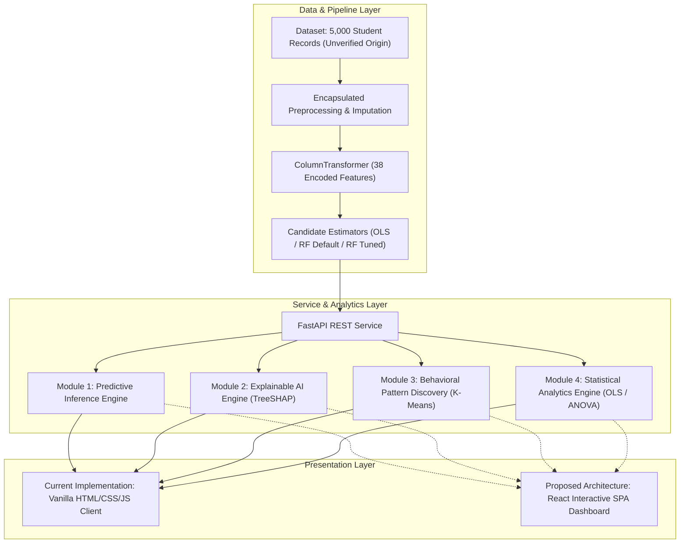
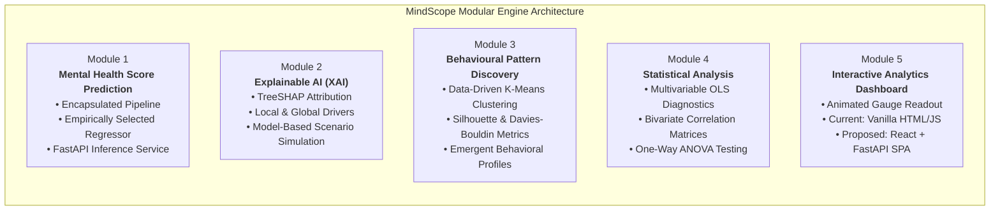
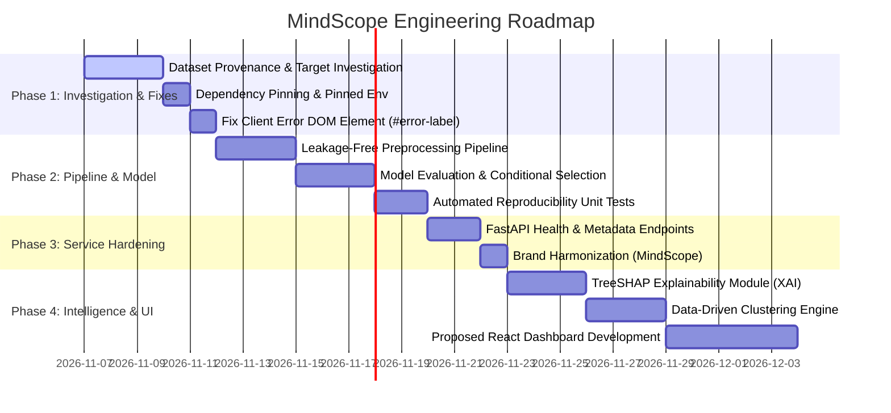

# MindScope — Student Mental Health Analytics & Predictive Intelligence Platform
## Foundational Project Requirements & System Specification Document

- **Document Version:** 1.2.0
- **Status:** Final Methodological Specification
- **System Scope:** Standalone Predictive Analytics & Behavioral Intelligence Platform
- **Date of Formulation:** November 2026
- **Reference Baselines:** MindScope Technical Architecture & Codebase Audit Report (v1.0.0), Empirical Target Investigation (v1.1.0)

---

## 1. Project Overview

**MindScope** is an end-to-end predictive intelligence and behavioral analytics platform engineered to model, interpret, and monitor student lifestyle and digital behavioral signals.

In modern higher education, academic workload, digital device engagement, fragmented sleep schedules, and varied stress levels form complex behavioral patterns. MindScope leverages statistical modeling and supervised machine learning to quantify relationships between these daily lifestyle factors and an overall continuous mental wellness score.

MindScope is designed as an independent, full-stack predictive system featuring:
- A scikit-learn machine learning regression pipeline trained on multidimensional student behavioral data.
- A high-performance, asynchronous REST API service built with FastAPI and validated using Pydantic schemas.
- A client presentation interface delivering real-time scoring, feature attribution, and interactive visual feedback.
  - *Current Implementation:* Lightweight, single-page interface built with vanilla HTML5, CSS3, and ES6+ JavaScript.
  - *Proposed Target Architecture:* Component-driven modern web application built with **React and FastAPI**, providing modular state management, rich data visualizations, and interactive analytics.
- Modular analytical engines supporting Explainable AI (XAI), unsupervised lifestyle clustering, statistical hypothesis testing, and population benchmarking.



---

## 2. Problem Statement

University students navigate demanding schedules characterized by intensive academic deadlines, high device dependency, irregular sleep patterns, and elevated stress. While students and institutional advisors often recognize that sleep deprivation and excessive screen time coincide with feeling overwhelmed, existing institutional methods for monitoring well-being face notable operational limitations:

1. **Infrequent Assessment Cycles:** Academic institutions typically conduct campus-wide wellness surveys once per semester or year, missing transient fluctuations that occur during midterms or assignment crunch periods.
2. **Lack of Synthesized Behavioral Context:** Standard digital tracking utilities (such as smartphone screen-time counters) report raw usage durations in isolation, offering no predictive synthesis of how screen time interacts with sleep duration, physical activity, and study habits.
3. **Absence of Model Interpretability:** Conventional analytics rarely explain *how* individual lifestyle factors combine to influence an overall score, making it difficult for users to evaluate which behavioral adjustments relate most strongly to positive score changes.

MindScope addresses these challenges by developing a non-clinical behavioral intelligence platform that models multidimensional lifestyle patterns, provides continuous score estimation, and delivers transparent, model-based explanations of factor contributions.

> [!IMPORTANT]
> **Non-Clinical Behavioral Analytics Scope:**  
> MindScope is strictly an informational and educational data science platform. It does not perform psychiatric diagnosis, medical screening, or psychological assessment. It does not substitute for professional medical advice, diagnosis, or treatment.

---

## 3. Project Objectives

### 3.1 Primary Analytical & Engineering Objectives
1. **Continuous Score Prediction:** Develop and validate a regression pipeline capable of predicting a student's continuous `Mental_Health_Score` from lifestyle and demographic inputs. The platform targets aspirational performance thresholds of $R^2 \ge 0.85$, $\text{MAE} \le 0.40$, and $\text{RMSE} \le 0.50$, evaluated under rigorous holdout and cross-validation procedures.
2. **Local and Global Explainability:** Integrate Explainable AI (XAI) capabilities using TreeSHAP to decompose individual predictions into positive and negative feature attributions, clarifying the relative importance of sleep, screen time, study, and stress.
3. **Data-Driven Pattern Discovery:** Apply unsupervised clustering to discover natural lifestyle archetypes directly from the data, evaluating cluster cohesion and separation using the silhouette score and Davies-Bouldin index.
4. **Rigorous Statistical Baselines:** Establish multivariable regression baselines (Ordinary Least Squares) and inferential tests (ANOVA) to report effect sizes, confidence intervals, and parametric associations across platform choices and stress levels.
5. **Production Engineering & Stability:** Build a robust, containerized application with strict schema validation, reproducible execution within a pinned software environment, and sub-100ms API inference latency under specified benchmark conditions.

### 3.2 Non-Objectives
- MindScope is **not** a clinical diagnostic instrument, psychiatric diagnostic tool, or medical triage system.
- MindScope does not prescribe therapeutic, pharmacological, or clinical interventions.
- MindScope does not collect real-time device telemetry, background keylogging, or intrusive surveillance data.
- MindScope does not claim causal intervention efficacy; counterfactual simulations represent model-based scenarios under learned distributions, not guaranteed real-world outcomes.

---

## 4. Target Users and Intended Use Cases

| User Persona | Context & Needs | Primary MindScope Use Case |
| :--- | :--- | :--- |
| **University Students** | Desires self-reflection on how daily habits (screen exposure, sleep, physical activity) align with modeled well-being scores. | Inputs daily routine estimates into the interactive client to observe predicted score readouts, model-based feature attributions, and comparative population percentiles. |
| **Academic & Student Life Advisors** | Seeks objective behavioral discussion points during routine student support meetings. | Reviews self-reported lifestyle inputs and model feature attributions to facilitate informed conversations about sleep hygiene and balanced device habits. |
| **Educational Researchers** | Analyzes population trends and cross-sectional associations across platforms and academic levels. | Utilizes the statistical analytics and clustering endpoints to evaluate cohort-level lifestyle distributions and examine correlation structures. |
| **Data Science Reviewers & Auditors** | Evaluates machine learning engineering, pipeline integrity, and architectural rigor. | Inspects the reproducible machine learning pipeline, cross-validation protocols, REST endpoints, and architectural modularity. |

---

## 5. Research Questions

MindScope investigates five central empirical research questions:

- **RQ1 (Screen Time vs. Sleep Association):** What is the relative magnitude and direction of association between daily social media usage (`Avg_Daily_Usage_Hours`) and nightly sleep duration (`Sleep_Hours_Per_Night`) with respect to `Mental_Health_Score` in a multivariable predictive model?
- **RQ2 (Platform and Usage Motivation Specificity):** Controlling for total daily screen time, study duration, and demographic covariates within a multivariable regression framework, do specific social media platforms or primary motivations for use exhibit statistically significant associations with `Mental_Health_Score`?
- **RQ3 (Physical Activity as an Associational Moderator):** Is higher daily physical activity positively associated with higher mental health scores among student subgroups exhibiting high screen exposure ($> 6\text{h}$) and elevated stress levels?
- **RQ4 (Empirical Behavioral Archetypes):** Do unsupervised clustering algorithms identify distinct, statistically cohesive student lifestyle groupings based on digital and recovery habits, and how do average mental health scores vary across these emergent clusters?
- **RQ5 (Comparison of Explanatory Methods):** How do feature importance rankings and localized attribution patterns derived from non-linear TreeSHAP compare with coefficients from multivariable linear regression, and what discrepancies arise from feature interactions and non-linearities?

---

## 6. Dataset Description & Provenance

MindScope uses a structured cross-sectional tabular dataset:

- **File Identifier:** `Student Social Media And Mental Health Impact.csv`
- **Volume & Retention Policy:** 5,000 raw records. The original dataset file is preserved without in-place modification.
- **Dimensionality:** 13 columns (1 target variable, 12 feature variables).
- **Data Cleaning Protocol:** Exactly **2 duplicate records** exist in the raw dataset (`df.duplicated().sum() == 2`). In the documented preprocessing workflow, these two duplicate rows are programmatically removed, leaving **4,998 unique records** for training and evaluation. All cleaning decisions are documented in code.
- **Dataset Provenance & Collection Methodology:** **Unverified**. The exact data source, institutional origin, survey instrument, sampling methodology, and collection protocols are undocumented in the repository. While statistical characteristics (such as high linear correlations $|r| > 0.75$ and complete absence of missing entries) suggest possible synthetic data generation, this remains an unconfirmed hypothesis rather than an established fact. The dataset is preserved as an empirical benchmark without asserting that it represents independently verified observational field research.
- **Data Completeness:** 100% complete across all columns (zero missing or null cells).
- **Domain Outlier Treatment:** `Physical_Activity_Hours` contains **10 negative records** (minimum $-0.40$), requiring programmatic lower-bound clipping at 0.0 inside the preprocessing pipeline.

---

## 7. Feature Descriptions and Target Variable

### 7.1 Input Features (Predictors)

| Feature Name | Data Type | Domain Range (Dataset) | System Validation Range | Description & Domain Context |
| :--- | :--- | :--- | :--- | :--- |
| `Age` | Integer | $[18, 24]$ | $[18, 24]$ (Strict) | Age of respondent. Dataset domain: exactly $18–24$ (Mean: 20.82 years). Initial deployment accepts ages $18–24$ only; ages $< 18$ or $> 24$ are strictly rejected with HTTP 422. Expanding age support requires additional representative data and independent validation. |
| `Gender` | Categorical | `{'Male', 'Female'}` | `{'Male', 'Female'}` | Binary biological sex or self-identified gender category. |
| `Country` | Categorical | 111 unique values | Any string (mapped) | High-cardinality geographic feature. Most frequent: `Other` (37.6%), `India` (7.8%), `USA` (7.1%), `Canada` (4.6%), `Australia` (4.0%), `UK` (3.7%). |
| `Academic_Level` | Categorical | 3 levels | `{'High School', 'Undergraduate', 'Graduate'}` | Current educational stage. Undergraduates constitute 72.6% of records. |
| `Most_Used_Platform` | Categorical | 12 platforms | 12 supported platforms | Primary platform: Instagram, TikTok, Facebook, LinkedIn, YouTube, Twitter, Snapchat, WhatsApp, LINE, VKontakte, KakaoTalk, WeChat. |
| `Purpose_Of_Use` | Categorical | 4 categories | `{'Entertainment', 'Education', 'Networking', 'News'}` | Primary self-reported digital engagement motivation. |
| `Avg_Daily_Usage_Hours` | Continuous | $[1.0, 8.8]$ | $[0.0, 24.0]$ | Total daily social media usage in hours. |
| `Daily_Unlocks` | Discrete | $[62, 273]$ | $[0, \infty)$ | Estimated daily smartphone unlock count. |
| `Study_Hours` | Continuous | $[0.3, 8.3]$ | $[0.0, 24.0]$ | Dedicated daily academic study hours outside class. Right-skewness: $+0.436$. |
| `Physical_Activity_Hours`| Continuous | $[-0.4, 4.1]$ | $[0.0, 24.0]$ | Daily deliberate exercise. Raw data requires clipping at 0.0. |
| `Sleep_Hours_Per_Night` | Continuous | $[3.6, 9.9]$ | $[0.0, 24.0]$ | Average nightly sleep hours. Dataset mean: 6.63 hours. |
| `Stress_Level` | Categorical | 4 ordered tiers | `{'Low', 'Medium', 'High', 'Very High'}` | Self-reported perceived stress tier. |

### 7.2 Target Variable (`Mental_Health_Score`)

- **Attribute Identifier:** `Mental_Health_Score`
- **Measurement Type:** Continuous numerical value (`float64`), discretized to 1 decimal place.
- **Observed Empirical Range:** $[3.60, 9.40]$ (Mean: 6.231, Median: 6.100, Std: 1.279, Skewness: $+0.207$, Kurtosis: $-0.803$).
- **Quantization & Heaping Characteristics:** As established in `docs/TARGET_VARIABLE_INVESTIGATION.md`, the score spans exactly 59 discrete values from 3.6 to 9.4 in uniform 0.1 increments. Round integer numbers (`5.0`, `6.0`, `7.0`, `8.0`) exhibit pronounced digit preference/heaping, accounting for 27.84% of all records (nearly $3\times$ uniform expectation).
- **Theoretical Bounded Scale:** Displayed on a $0.00–10.00$ scale for intuitive user interpretation.
- **Target Variable Investigation Status:**  
  The empirical investigation requirement is **completed** and documented in `docs/TARGET_VARIABLE_INVESTIGATION.md`:
  1. *Directionality Established:* Higher scores empirically denote balanced, resilient lifestyle habits (positively associated with sleep, study, and physical activity), while lower scores reflect behavioral strain (strongly associated with elevated screen time, high unlocks, and high stress).
  2. *Non-Deterministic Construction:* Simple OLS explains $70.9\%$ of variance ($R^2 = 0.709$), while non-linear tree ensembles plateau at a 5-fold cross-validated $R^2 \approx 0.878$, confirming that the score is not an exact deterministic formula and contains $\approx 12.2\%$ residual stochastic variance ($\text{RMSE} \approx 0.45$).
- **Non-Clinical Score Interpretation:**  
  MindScope rejects predetermined or clinically calibrated "diagnostic risk bands" (e.g., classifying scores into clinical depression or anxiety tiers). Instead, the system treats `Mental_Health_Score` strictly as an empirical regression outcome. Any visual categorizations (e.g., lower, middle, or upper relative tiers) are presented as descriptive, cohort-relative percentiles without diagnostic connotation.

---

## 8. Functional Requirements

### 8.1 Data Preprocessing & Pipeline Integrity
- **FR-01 [Existing / Verified]:** The system shall map high-cardinality `Country` values to the top 10 most frequent classes (`Other`, `India`, `USA`, `Canada`, `Australia`, `UK`, `Germany`, `Mexico`, `Turkey`, `France`) and bucket all other entries into `'Other'`.
- **FR-02 [Proposed / Hardening]:** Preprocessing transformations—including country grouping, outlier clipping, log transforms, standard scaling, and one-hot encoding—shall be encapsulated within scikit-learn transformers fitted strictly on training data splits to prevent data leakage.
- **FR-03 [Proposed / Robustness]:** The pipeline shall integrate `SimpleImputer` fallbacks across numerical (`strategy='median'`) and categorical (`strategy='most_frequent'`) branches as a defensive engineering safeguard against missing values in production payloads.
- **FR-04 [Existing / Verified]:** The skewed feature `Study_Hours` shall undergo a $\log(1 + x)$ transformation prior to standard scaling.

### 8.2 Model Execution & REST Inference Service
- **FR-05 [Existing / Verified]:** The service shall expose a `POST /predict` endpoint accepting inputs matching the `StudentData` Pydantic schema and returning `PredictionResponse`.
- **FR-06 [Proposed / Hardening]:** The service shall strictly validate input values within the empirically supported domain. For initial deployment, the service shall enforce `Age` within $[18, 24]$, rejecting inputs with $\text{Age} < 18$ or $\text{Age} > 24$ with structured HTTP 422 error responses. Operational bounds for lifestyle features shall be enforced as engineering safeguards.
- **FR-07 [Proposed / Service Upgrade]:** The service shall expose a `GET /health` endpoint reporting system uptime, model metadata, and pipeline readiness.
- **FR-08 [Proposed / Architecture]:** The FastAPI service shall serve the static client assets or provide an integrated proxy for the frontend application.
- **FR-09 [Proposed / Model Selection]:** Final model deployment shall be determined based on reproducible cross-validation, holdout performance, residual error analysis, and generalizability across candidate models (including Linear Regression, Random Forest, and other justified models), rather than mandating any specific algorithm in advance.

### 8.3 Explainable AI (XAI)
- **FR-10 [Proposed / New]:** The platform shall compute localized Shapley values ($\phi_i$) for individual predictions using TreeSHAP, providing positive and negative score attribution breakdowns. System documentation and API outputs shall explicitly disclose attribution limitations arising from correlated and structurally redundant features, and shall not represent SHAP attributions as causal effects.
- **FR-11 [Proposed / New]:** The platform shall report global feature attributions ranking predictors by Mean Absolute SHAP value across the training population.
- **FR-12 [Proposed / New]:** The platform shall provide model-based scenario simulations (*"What-If" Analysis*), calculating projected score adjustments if selected habits (e.g., sleep duration or screen time) are modified, explicitly framing these as statistical model projections rather than guaranteed causal outcomes.

### 8.4 Pattern Discovery, Redundancy & Statistical Analytics
- **FR-13 [Proposed / New]:** The platform shall implement unsupervised clustering (e.g., K-Means or Gaussian Mixture Models) where cluster count ($k$) and behavioral interpretations are driven by empirical data evaluation using silhouette analysis and the Davies-Bouldin index, without predetermined archetype labels.
- **FR-14 [Proposed / New]:** The platform shall provide population benchmark comparisons, situating user inputs against cohort percentiles ($25\text{th}$, $50\text{th}$, $75\text{th}$).
- **FR-15 [Proposed / New]:** The platform shall calculate bivariate correlation matrices and multivariable Ordinary Least Squares regression coefficients with corresponding standard errors and 95% confidence intervals.
- **FR-20 [Proposed / Redundancy Evaluation]:** The modeling pipeline shall retain both `Most_Used_Platform` and `Purpose_Of_Use` in the baseline feature schema. During Phase 2, the system shall systematically evaluate a full-feature model against a reduced-feature variant, comparing predictive performance, feature importance stability, SHAP attribution fidelity, and interpretability without prematurely dropping features.

### 8.5 Client Interface & Visualization
- **FR-16 [Existing / Current Baseline]:** The platform shall maintain a responsive, functional baseline web client built with vanilla HTML5, CSS3, and ES6+ JavaScript.
- **FR-17 [Existing / Current Baseline]:** The interface shall render an animated SVG semicircular gauge visualizing predicted scores on a $0–10$ scale.
- **FR-18 [Proposed / Bug Fix]:** The interface shall resolve the missing `#error-label` DOM element in `index.html` to ensure graceful display of client-side and server-side validation errors.
- **FR-19 [Proposed / Architecture Evolution]:** The platform shall specify a modern, component-driven **React + FastAPI** architecture for the production dashboard, supporting modular component state, dynamic charting (e.g., Chart.js / Recharts), and responsive analytical views.

---

## 9. Non-Functional Requirements

### 9.1 Performance & Latency
- **NFR-01 (Inference Latency):** Under benchmark conditions (pre-warmed model, single-threaded execution on modern x86-64 hardware, local network latency excluded), single-sample prediction latency through the FastAPI endpoint shall not exceed 100 milliseconds for the 95th percentile ($p95 < 100\text{ms}$).
- **NFR-02 (Application Startup):** The backend service shall complete initialization, dependency loading, and model deserialization within 5.0 seconds.
- **NFR-03 (Model Storage Footprint):** The serialized model artifact shall not exceed 50 MB on disk.

### 9.2 Reliability & Fault Tolerance
- **NFR-04 (Input Rejection):** Payloads violating type constraints, containing unparseable values, or exceeding defined ranges shall be rejected with HTTP 422 and actionable error messaging.
- **NFR-05 (Client Error Handling):** Client applications shall catch and present network disconnects, server errors, and validation rejections gracefully without unhandled script crashes.

### 9.3 Portability & Reproducibility
- **NFR-06 (Software Environment Pinning):** The platform shall document and pin all dependency versions in `requirements.txt` to ensure exact reproducibility across Python environments.
- **NFR-07 (Deterministic Pipeline Execution):** All random state generators across model fitting, data partitioning, and cross-validation shall be fixed at `random_state=42`.

### 9.4 Usability & Accessibility
- **NFR-08 (Design Cohesion):** The user interface shall adhere to a clean design system utilizing defined typography, accessible color contrast ratios, and clear field labeling.
- **NFR-09 (Responsive Form Factors):** The interface shall render legibly across mobile ($320\text{px}+$ viewport), tablet ($768\text{px}+$ viewport), and desktop ($1024\text{px}+$ viewport) displays.

---

## 10. Five Proposed Platform Modules



### 10.1 Module 1: Mental Health Score Prediction
- **Description:** Core predictive engine that ingests student lifestyle variables, performs verified pipeline preprocessing, and outputs a continuous predicted score.
- **Model Selection Protocol:** Rather than predetermining the deployment of Random Forest or any specific algorithm, final model selection is conditional on comparative cross-validation performance, holdout generalizability, residual distribution, and resistance to overfitting across candidate estimators (including Linear Regression, Random Forest, Gradient Boosting, and regularized linear models).
- **Input / Output Specification:**
  - Input: 12 student demographic and behavioral fields.
  - Output: Continuous predicted score $\hat{y} \in [0.00, 10.00]$, descriptive percentile context, and model metadata.

### 10.2 Module 2: Explainable AI (XAI)
- **Description:** Interpretability engine providing localized and population-level insight into model predictions.
- **Methodology:** Implements TreeSHAP to calculate exact Shapley attributions:
  $$\hat{y}(x) = \phi_0 + \sum_{i=1}^{M} \phi_i(x)$$
  where $\phi_0$ is the base expected value of the training distribution and $\phi_i$ is the point contribution of feature $i$.
- **Attribution & Causal Disclaimer:** System outputs shall explicitly state that SHAP attributions reflect statistical associations within the trained model and cannot be interpreted as causal effects. Documentation shall disclose how collinearity between structurally paired features (e.g., platform and purpose) influences split credit in tree ensembles.
- **Model-Based Scenario Simulation:** Enables users to explore exploratory "what-if" parameter adjustments (e.g., $\Delta \text{sleep} = +1\text{h}$, $\Delta \text{screen time} = -1\text{h}$), explicitly presenting results as statistical model projections under learned distributions rather than guaranteed causal interventions.

### 10.3 Module 3: Behavioural Pattern Discovery
- **Description:** Unsupervised learning engine for uncovering student behavioral groupings directly from empirical data.
- **Clustering Strategy:**
  - Standardized feature inputs: continuous usage, sleep, study, unlock, and physical activity metrics.
  - Optimal cluster count ($k$) determined empirically via silhouette analysis and Davies-Bouldin index optimization.
  - Cluster profiles and descriptions are derived strictly post-hoc from observed cluster centroids rather than applying predetermined labels or clinical archetypes.

### 10.4 Module 4: Statistical Analysis
- **Description:** Classical inferential statistics engine providing foundational parametric analysis and hypothesis testing.
- **Analytical Outputs:**
  - Multivariable Ordinary Least Squares (OLS) regression reporting unstandardized weights ($\beta_i$), standard errors, $t$-statistics, $p$-values, and 95% confidence intervals.
  - One-way ANOVA tests examining score variance across categorical dimensions (`Stress_Level`, `Academic_Level`, `Most_Used_Platform`) with reported $F$-statistics and effect sizes ($\eta^2$).
  - Bivariate Pearson $r$ and Spearman $\rho$ correlation matrices detailing linear and monotonic associations among continuous variables.

### 10.5 Module 5: Interactive Analytics Dashboard
- **Description:** User-facing presentation layer integrating model scoring, feature attributions, and exploratory data visualizations.
- **Architectural Distinction:**
  - *Current Implementation:* Vanilla HTML5, CSS3, and ES6+ JavaScript (`index.html`, `style.css`, `script.js`) featuring an animated SVG gauge and direct API fetch calls.
  - *Proposed Target Architecture:* A modern **React + FastAPI** single-page application incorporating reusable UI components, centralized state management, responsive charting (e.g., Chart.js or Recharts), and dedicated tabs for Assessment, Attribution Breakdown, and Population Analytics.

---

## 11. Proposed Technology Stack

| System Tier | Component / Technology | Pinned Version Specification | Role & Technical Justification |
| :--- | :--- | :--- | :--- |
| **Runtime Environment** | Python | `>=3.10, <=3.12` | Stable execution environment with broad scientific package support. |
| **Machine Learning Core** | `scikit-learn` | `==1.5.2` (or pinned stable) | Encapsulated pipelines, estimators, cross-validation, and metrics. |
| **Model Persistence** | `joblib` | `==1.4.2` | Robust disk serialization for trained scikit-learn pipelines. |
| **Data Processing** | `pandas` | `==2.2.3` | Tabular data manipulation and validation. |
| **Numerical Computing** | `numpy` | `==2.0.2` | Vectorized mathematical operations and array transformations. |
| **Explainable AI (XAI)** | `shap` | `==0.46.0` | Game-theoretic TreeSHAP feature attribution calculations. |
| **Inferential Statistics** | `scipy` / `statsmodels` | `==1.14.1` / `==0.14.4` | Parametric hypothesis testing (ANOVA) and OLS regression analysis. |
| **Backend Service** | `FastAPI` | `==0.115.5` | High-throughput asynchronous ASGI web framework. |
| **Data Validation** | `pydantic` | `==2.10.2` | Runtime data validation and schema serialization. |
| **ASGI Server** | `uvicorn` | `==0.32.1` | Production ASGI web server. |
| **Current Frontend** | Vanilla HTML5 / CSS3 / ES6+ | Native Browser Standards | Lightweight, zero-dependency baseline client currently in repository. |
| **Proposed Target Frontend** | **React + Vite / TypeScript** | `React 18.x / 19.x` | Proposed modular SPA architecture for advanced dashboard views. |
| **Automated Testing** | `pytest` / `httpx` | `==8.3.3` / `==0.28.1` | Unit and integration testing for pipelines and API endpoints. |

---

## 12. High-Level System Architecture

```
┌─────────────────────────────────────────────────────────────────────────────┐
│                       PRESENTATION LAYER (CLIENT UI)                        │
│                                                                             │
│   [Current Baseline: Vanilla HTML/CSS/JS]    [Proposed Target: React SPA]   │
│   ┌─────────────────────┐   ┌───────────────────────┐   ┌───────────────┐   │
│   │ Input Profile Form  │   │ Animated Visual Gauge │   │ SHAP Feature  │   │
│   │ (HTML5 / Datalists) │   │ (SVG stroke-dashoffset)│   │ Attribution   │   │
│   └──────────┬──────────┘   └───────────▲───────────┘   └───────▲───────┘   │
└──────────────┼──────────────────────────┼───────────────────────┼───────────┘
               │ JSON Request             │ JSON Prediction       │ Local Attributions
               ▼                          │                       │
┌─────────────────────────────────────────┴───────────────────────┴───────────┐
│                      SERVICE LAYER (FASTAPI REST ENGINE)                    │
│                                                                             │
│   ┌─────────────────────────────────────────────────────────────────────┐   │
│   │ Pydantic Validation Gateway (StudentData Schema Constraints)        │   │
│   └──────────────────────────────────┬──────────────────────────────────┘   │
│                                      │ Validated Payload                    │
│   ┌──────────────────────────────────▼──────────────────────────────────┐   │
│   │ MindScope Router (/predict, /health, /explain, /analytics)           │   │
│   └──────┬───────────────────────────┬───────────────────────────┬──────┘   │
└──────────┼───────────────────────────┼───────────────────────────┼──────────┘
           │ Input DataFrame           │ Tree Traversals           │ Feature Arrays
           ▼                           ▼                           ▼
┌──────────────────────┐    ┌──────────────────────┐    ┌─────────────────────┐
│   ML PIPELINE        │    │   EXPLAINABILITY     │    │   STATISTICAL       │
│   • ColumnTransformer│    │   • TreeSHAP Engine  │    │   ANALYTICS ENGINE  │
│   • StandardScaler   │    │   • Waterfall Attrib.│    │   • K-Means Clusters│
│   • OneHotEncoder    │    │   • Model-Based      │    │   • ANOVA & OLS     │
│   • Evaluated Model  │    │     Scenario Sim     │    │   • Correlations    │
│     (Conditional     │    └──────────────────────┘    └─────────────────────┘
│      Selection)      │                                                      
└──────────────────────┘                                                      
```

---

## 13. Machine Learning Evaluation Methodology

### 13.1 Partitioning & Validation Protocol
- **Dataset Partitioning:** Standardized 70/30 train-test split (3,498 training samples, 1,500 holdout testing samples) with a fixed seed (`random_state=42`).
- **Fold-Level Preprocessing Encapsulation:** To eliminate data leakage, all preprocessing transformations (scaling, imputers, log transforms, and category encodings) must be fit independently within each training fold during cross-validation, and fit only on `X_train` during holdout evaluation.
- **Cross-Validation & Unbiased Model Selection:**
  - Standard 5-fold cross-validation is conducted within the training data ($N=3,498$).
  - *Methodological Safeguard:* If hyperparameter optimization (e.g. `RandomizedSearchCV` or `GridSearchCV`) and reported model performance use the same cross-validation folds, optimistic performance bias can occur. The modeling protocol shall implement **nested cross-validation** (outer 5-fold CV for performance estimation; inner 3-fold or 5-fold CV for hyperparameter tuning) or an equivalent unbiased model-selection procedure.
  - *Strict Holdout Isolation:* The 30% holdout test set ($N=1,500$) must **never be used repeatedly for model selection or tuning**. It is strictly reserved for the final, unbiased evaluation of the chosen deployment pipeline.

### 13.2 Evaluation Metrics & Aspirational Targets

#### Primary Regression Metrics (Calculated on Unrounded Predictions)
All primary performance metrics must be computed directly on continuous, unrounded floating-point model predictions ($\hat{y}$):
1. **Coefficient of Determination ($R^2$):**
   $$R^2 = 1 - \frac{\sum_{i=1}^{n} (y_i - \hat{y}_i)^2}{\sum_{i=1}^{n} (y_i - \bar{y})^2}$$
   *Aspirational Target Threshold:* $R^2 \ge 0.85$ on holdout testing.
2. **Mean Absolute Error (MAE):**
   $$\text{MAE} = \frac{1}{n} \sum_{i=1}^{n} |y_i - \hat{y}_i|$$
   *Aspirational Target Threshold:* $\text{MAE} \le 0.40$ score points.
3. **Root Mean Squared Error (RMSE):**
   $$\text{RMSE} = \sqrt{\frac{1}{n} \sum_{i=1}^{n} (y_i - \hat{y}_i)^2}$$
   *Aspirational Target Threshold:* $\text{RMSE} \le 0.50$ score points.

#### Supplementary Tolerance Metrics
Because `Mental_Health_Score` is recorded in discrete $0.1$ increments with integer concentrations, the evaluation protocol incorporates supplementary tolerance metrics:
- **$\text{Tol}_{0.1}$:** Percentage of predictions within $\pm 0.1$ of the recorded score ($|y_i - \hat{y}_i| \le 0.10$).
- **$\text{Tol}_{0.2}$:** Percentage of predictions within $\pm 0.2$ of the recorded score ($|y_i - \hat{y}_i| \le 0.20$).

> [!NOTE]
> **Interpretation of Supplementary Metrics:**  
> Tolerance metrics provide descriptive diagnostics of error concentration around the recorded values. They **do not establish clinical or real-world diagnostic validity**, and must be reported alongside primary unrounded regression metrics.

### 13.3 Candidate Model Comparison & Selection Criteria
The platform shall evaluate a diverse set of candidate estimators rather than predetermining a single architecture:
1. **Ordinary Least Squares (OLS) / Ridge / ElasticNet:** Parametric linear baselines providing coefficients, standard errors, and baseline variance.
2. **Random Forest Regressor:** Non-linear bagging ensemble capable of capturing non-linear interactions across bounded tree depths.
3. **Gradient Boosting (GBR / HistGradientBoosting):** Sequential boosting ensemble evaluating whether gradient optimization improves test-set residuals.
4. **Feature Variant Comparison:** Evaluating both the full 12-feature schema and a reduced-feature variant (addressing the observed redundancy between `Most_Used_Platform` and `Purpose_Of_Use`).

**Final Selection Protocol:**  
The model selected for production deployment will be chosen based on reproducible cross-validation, generalization performance on holdout data, residual normality, resistance to overfitting, and interpretability under SHAP, without an automatic preference for any specific model family.

### 13.4 Historical Baseline Benchmarks

The following baseline results reflect historical benchmarks established during initial project experimentation and verified in the technical audit. They represent reference points, not guaranteed performance metrics for future pipeline iterations:

| Estimator Pipeline | Training $R^2$ | Testing $R^2$ | Testing MAE | Testing RMSE | Observed Characteristic |
| :--- | :---: | :---: | :---: | :---: | :--- |
| **Linear Regression (Baseline)** | 0.7237 | 0.7398 | 0.5362 | 0.6760 | Stable, non-overfitted linear baseline. |
| **Random Forest (Default)** | 0.9808 | 0.8776 | 0.3472 | 0.4637 | Lowest holdout test error, but exhibits severe training overfitting. |
| **Random Forest (Tuned)** | 0.9547 | 0.8650 | 0.3689 | 0.4869 | Cross-validated hyperparameter configuration with bounded depth. |

---

## 14. Data Quality, Validation and Preprocessing Requirements

### 14.1 Input Validation Specifications
API boundary validation must conform to realistic demographic and behavioral ranges aligned with empirical training distributions while preventing extreme out-of-distribution extrapolation:
- `age`: Integer within $[18, 35]$ (dataset training domain: $[18, 24]$; extended to 35 to accommodate adult learners while rejecting extreme outliers).
- `gender`: Exact membership in `{'Male', 'Female'}`.
- `country`: String input. Recognized top 10 countries mapped directly; all others mapped to `'Other'`.
- `academic_level`: Exact membership in `{'High School', 'Undergraduate', 'Graduate'}`.
- `most_used_platform`: Exact membership in the 12 supported platform strings.
- `purpose_of_use`: Exact membership in `{'Networking', 'Education', 'Entertainment', 'News'}`.
- `avg_daily_usage_hours`: Continuous float within $[0.0, 16.0]$ (training domain: $[1.0, 8.8]$).
- `daily_unlocks`: Integer within $[0, 500]$ (training domain: $[62, 273]$).
- `study_hours`: Continuous float within $[0.0, 16.0]$ (training domain: $[0.3, 8.3]$).
- `physical_activity_hours`: Continuous float within $[0.0, 8.0]$ (training domain: $[0.0, 4.1]$ with lower-bound clipping at 0.0).
- `sleep_hours_per_night`: Continuous float within $[2.0, 16.0]$ (training domain: $[3.6, 9.9]$).
- `stress_level`: Exact membership in `{'Low', 'Medium', 'High', 'Very High'}`.

### 14.2 Pipeline Robustness Safeguards
1. **Defensive Imputation:** Embed `SimpleImputer` inside all sub-pipelines to prevent pipeline failure on incomplete incoming data.
2. **Domain Boundary Clipping:** Ensure non-negative bounds for physical activity and screen duration.
3. **Strict Column Filtering:** Ensure preprocessors drop extraneous input keys prior to model inference.

---

## 15. Ethical Considerations, Privacy and Limitations

### 15.1 Explicit Non-Clinical Positioning
> [!WARNING]
> **Non-Clinical Disclaimer:**  
> MindScope is not a diagnostic tool and does not provide clinical mental health evaluations. The platform estimates statistical wellness scores strictly for informational and self-reflection purposes. Users experiencing psychological distress must be directed to university counseling services, crisis hotlines, or licensed mental health professionals.

### 15.2 Dataset Limitations & Uncertainty Reporting
- The dataset's provenance and collection methodology remain unverified.
- High linear correlation coefficients may reflect synthetic generation mechanisms; findings must not be treated as generalizable empirical truths across broader student populations.
- All published statistical analyses must report standard errors, confidence intervals, effect sizes, and explicit notes on sample limitations.

### 15.3 Privacy & Data Stewardship
- MindScope requires no personally identifiable information (PII) such as student names, identification numbers, email addresses, or IP addresses.
- Prediction requests are processed ephemerally in volatile memory without database persistence.
- Network communications in production deployments must be secured using HTTPS/TLS.

---

## 16. Development Milestones and Acceptance Criteria



### Milestone 1: Investigation, Environment Pinning & Defect Remediation
- **Goal:** Document dataset findings, resolve environment inconsistencies, and fix client runtime bugs.
- **Acceptance Criteria:**
  - **[COMPLETED]** Complete an empirical exploratory report investigating `Mental_Health_Score` distribution, directionality, quantization, integer heaping, correlation profile, and synthetic indicators (delivered in `docs/TARGET_VARIABLE_INVESTIGATION.md`).
  - Pin all dependencies in `requirements.txt` to eliminate unpickling warnings and `AttributeError` exceptions.
  - Add `<p class="error-label" id="error-label"></p>` into `index.html` to eliminate the JavaScript `TypeError` in `script.js`.
  - Update `script.js` to dynamically connect to local or remote endpoints based on origin.

### Milestone 2: Leakage Elimination, Model Re-Evaluation & Persistence
- **Goal:** Build an encapsulated, leakage-free pipeline, evaluate candidate estimators under unbiased validation, and persist the selected model.
- **Acceptance Criteria:**
  - Encapsulate country frequency grouping and clipping inside pipeline transformers fit strictly on `X_train` and independently within each cross-validation fold.
  - Include `SimpleImputer` fallbacks across all pipeline branches.
  - Implement nested cross-validation or an equivalent unbiased validation procedure to separate hyperparameter tuning from performance estimation, reserving the 30% holdout test set strictly for final evaluation.
  - Systematically evaluate candidate models (Linear Regression, Random Forest, Gradient Boosting, regularized linear models) across both full-feature (12 features) and reduced-feature variants.
  - Calculate primary regression metrics ($R^2$, MAE, RMSE) using unrounded predictions, alongside supplementary tolerance metrics ($\text{Tol}_{0.1}$, $\text{Tol}_{0.2}$).
  - Persist the selected model pipeline with zero serialization warnings within the pinned environment.
  - Implement automated unit tests verifying metric reproducibility and pipeline integrity.

### Milestone 3: Service Hardening & Brand Harmonization
- **Goal:** Standardize API service endpoints and unify platform identity.
- **Acceptance Criteria:**
  - Root route `/` returns structured JSON platform metadata (platform name, version, operational status).
  - `GET /health` endpoint reports model status, estimator type, and uptime metrics.
  - Update all user-facing client titles, headers, and metadata to the unified **MindScope** platform branding.

### Milestone 4: Advanced Analytics, Explainability & Proposed React Architecture
- **Goal:** Deliver the analytical modules and advance toward the proposed React application architecture.
- **Acceptance Criteria:**
  - `POST /explain` returns TreeSHAP feature attributions and model-based scenario projections.
  - Implement data-driven K-Means clustering with optimal $k$ selected via silhouette score and Davies-Bouldin index.
  - Implement multivariable OLS regression and ANOVA endpoints reporting 95% confidence intervals, standard errors, and effect sizes.
  - Prototype the proposed **React + FastAPI** dashboard architecture providing componentized views for Assessment, Model Explainability, and Population Analytics.
  - Achieve $> 90\%$ test coverage across API endpoints and data transformations.
