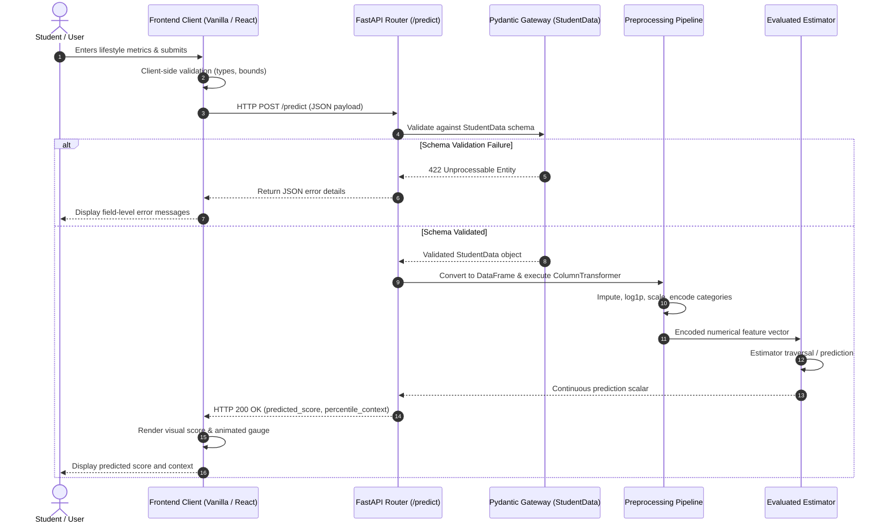
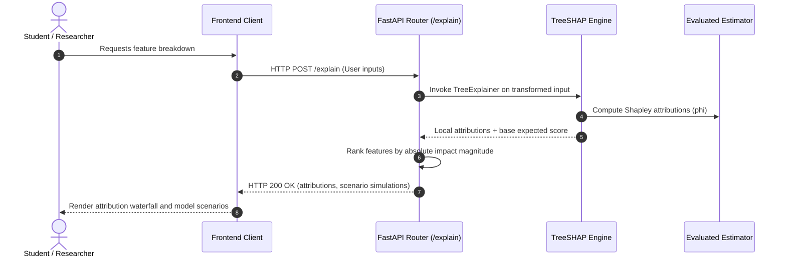

# MindScope — Student Mental Health Analytics & Predictive Intelligence Platform
## System Architecture & Technical Specification Document

- **Document Version:** 1.1.0
- **Status:** Approved Architectural Specification (Harmonized with Requirements v1.1.0)
- **Scope:** Full-Stack Machine Learning System Architecture
- **Date:** November 2026
- **Companion Specifications:** `docs/PROJECT_REQUIREMENTS.md`, `mindscope_audit_report.md`

---

## 1. Architectural Principles & System Goals

MindScope is architected as a modular, lightweight, and mathematically transparent predictive analytics platform. The system design adheres to the following engineering and scientific principles:

1. **Strict Pipeline Encapsulation:** All scaling, imputation, category mapping, and mathematical transformations are encapsulated within scikit-learn transformers. Preprocessing states are fitted strictly on training data splits and applied identically during inference, eliminating data leakage.
2. **Deterministic & Reproducible ML:** All random state initializations across model fitting, data partitioning, and cross-validation folds are fixed (`random_state=42`) within a pinned software environment, ensuring exact reproducibility.
3. **Decoupled Analytical Modules:** The platform separates continuous score prediction, model explainability (XAI), unsupervised lifestyle clustering, inferential statistics, and dashboard visualization into independent, testable computational engines.
4. **Conditional Model Selection:** Rather than predetermining a specific algorithm, final model deployment is conditional on rigorous cross-validation, holdout performance, residual error diagnostics, and generalizability across candidate estimators.
5. **Contract-Driven API Boundaries:** Strict schema enforcement via Pydantic models at the API gateway layer intercepts and rejects invalid, out-of-bounds, or malformed payloads before model pipeline invocation.
6. **Two-Stage Presentation Architecture:**
   - *Current Implementation:* Vanilla HTML5, modern CSS custom properties, and native ES6+ JavaScript for a lightweight, zero-dependency baseline.
   - *Proposed Target Architecture:* A component-driven modern single-page application built with **React and FastAPI**, supporting modular state management, rich data visualizations, and interactive analytics.
7. **Transparent Non-Clinical Framing:** What-if scenarios are framed as statistical model projections under learned distributions, not guaranteed causal interventions. The platform is explicitly positioned as non-clinical and non-diagnostic.

---

## 2. High-Level System Architecture

MindScope employs a four-tier architecture: **Data & Storage Layer**, **Machine Learning & Analytical Engine Layer**, **Service & Application Layer (FastAPI)**, and **Client Presentation Layer**.

```mermaid
graph TD
    subgraph Data & Storage Layer
        CSV[("Dataset CSV<br/>5,000 Records (Unverified Origin)")]
        ModelPKL[("Serialized Pipeline Artifact<br/>Mental_Health_Model.pkl")]
    end

    subgraph Core ML & Analytics Engines
        M1["Module 1: Predictive Inference Engine<br/>(Candidate Models Evaluated on CV & Holdout)"]
        M2["Module 2: Explainable AI Engine<br/>(TreeSHAP Kernel & Model Projections)"]
        M3["Module 3: Behavioral Clustering Engine<br/>(Data-Driven K-Means Clustering)"]
        M4["Module 4: Statistical Analytics Engine<br/>(OLS Regression & ANOVA Diagnostics)"]
    end

    subgraph Service Layer (FastAPI / Uvicorn)
        Gateway["Pydantic Validation Gateway<br/>(StudentData & Input Boundary Schemas)"]
        Router["FastAPI Application Router<br/>(/predict, /explain, /analytics, /health)"]
        Static["Static Asset Serving / API Proxy"]
    end

    subgraph Presentation Layer (Client Tier)
        subgraph Current Baseline
            VanillaUI["Vanilla HTML5 / CSS3 / ES6+ Client<br/>(index.html, style.css, script.js)"]
        end
        subgraph Proposed Target Architecture
            ReactUI["React Single-Page Application (SPA)<br/>(Componentized Views, State, Charting)"]
        end
    end

    CSV --> M3 & M4
    ModelPKL --> M1 & M2
    Gateway --> Router
    Router --> M1 & M2 & M3 & M4
    Static --> VanillaUI
    Router -.-> ReactUI
```

---

## 3. Component Breakdown & Module Specifications

### 3.1 Module 1: Predictive Inference Engine

- **Role:** Generates continuous predicted `Mental_Health_Score` ($\hat{y} \in [0.00, 10.00]$) and reports contextual percentile placement.
- **Model Selection Protocol:** Candidate estimators (Ordinary Least Squares, Default Random Forest, and Hyperparameter-Tuned Random Forest) are evaluated across 5-fold cross-validation and holdout test partitions. Final model selection prioritizes low generalization error and balanced residual distributions over unconstrained training fit.
- **Transformation Pipeline Flow:**

```
Raw Input Payload (12 features)
 │
 ├── Country Bucketing Transformer (Maps top-10 countries; all others to 'Other')
 │
 ├── Skewed Feature Branch ['Study_Hours']
 │     └── SimpleImputer(strategy='median')
 │     └── FunctionTransformer(np.log1p)
 │     └── StandardScaler()
 │
 ├── Plain Numeric Branch ['Age', 'Avg_Daily_Usage_Hours', 'Daily_Unlocks',
 │                         'Physical_Activity_Hours', 'Sleep_Hours_Per_Night']
 │     └── SimpleImputer(strategy='median')
 │     └── StandardScaler()
 │
 ├── Ordinal Categorical Branch ['Stress_Level']
 │     └── SimpleImputer(strategy='most_frequent')
 │     └── OrdinalEncoder(categories=[['Low', 'Medium', 'High', 'Very High']])
 │
 └── Nominal Categorical Branch ['Gender', 'Academic_Level', 'Most_Used_Platform',
 │                               'Purpose_Of_Use', 'Grouped_country']
       └── SimpleImputer(strategy='most_frequent')
       └── OneHotEncoder(handle_unknown='ignore', sparse_output=False)
 │
 └── Selected Estimator Pipeline ──> Continuous Predicted Score
```

### 3.2 Module 2: Explainable AI Engine (TreeSHAP)

- **Role:** Computes localized Shapley values decomposing individual predictions into positive and negative score contributions, and produces global feature attribution rankings.
- **Underlying Theory:** Uses the TreeSHAP algorithm to compute exact Shapley attributions:
  $$\hat{y}(x) = \phi_0 + \sum_{i=1}^{M} \phi_i(x)$$
  where $\phi_0$ is the base expected score across the training distribution, and $\phi_i$ represents the localized point contribution of feature $i$.
- **Model-Based Scenario Simulation:**
  - Evaluates sensitivity gradients for user-specified adjustments:
    $$\Delta \hat{y} = \hat{y}(x_{\text{adjusted}}) - \hat{y}(x)$$
  - Explicitly presented as **statistical model projections** under learned relationships, not guaranteed causal outcomes.

### 3.3 Module 3: Behavioral Clustering Engine

- **Role:** Identifies cohesive lifestyle groupings directly from empirical data without predetermined labels.
- **Clustering Methodology:**
  - Standardized continuous lifestyle metrics: `Avg_Daily_Usage_Hours`, `Daily_Unlocks`, `Study_Hours`, `Physical_Activity_Hours`, and `Sleep_Hours_Per_Night`.
  - Cluster count ($k$) selected empirically using silhouette analysis and Davies-Bouldin index optimization across a range of $k \in [2, 6]$.
  - Behavioral profiles and descriptive summaries are generated post-hoc from cluster centroid values and compared against cohort mental health score distributions.

### 3.4 Module 4: Statistical Analytics Engine

- **Role:** Performs inferential hypothesis testing, bivariate correlation analysis, and multivariate regression diagnostics.
- **Analytical Deliverables:**
  - **Correlation Matrices:** Pearson $r$ and Spearman rank $\rho$ coefficients across all continuous metrics.
  - **One-Way ANOVA Tests:** Assesses statistical significance of score variances across discrete categorical tiers (`Stress_Level`, `Academic_Level`, `Most_Used_Platform`) with reported $F$-statistics, $p$-values, and effect sizes ($\eta^2$).
  - **Multivariable OLS Diagnostics:** Parametric baseline regression reporting unstandardized feature weights ($\beta_i$), standard errors, $t$-statistics, $p$-values, and 95% confidence intervals.

### 3.5 Module 5: Interactive Analytics Dashboard

- **Role:** Graphical presentation layer delivering interactive scoring, explainability charts, and population comparisons.
- **Architectural Stages:**
  - *Current Baseline Client:* Semantic HTML5, CSS custom properties, and vanilla JavaScript (`index.html`, `style.css`, `script.js`) with an animated SVG gauge.
  - *Proposed Target Architecture:* A component-driven **React + FastAPI** single-page application featuring modular views for Assessment, Attribution Breakdown, and Population Analytics, supported by client-side charting libraries.

---

## 4. End-to-End Execution & Data Flow

### 4.1 Inference Request Sequence (`POST /predict`)



### 4.2 Explainability Request Sequence (`POST /explain`)



---

## 5. REST API Contract & Endpoint Specifications

### 5.1 System Monitoring Endpoints

#### `GET /`
- **Description:** System identity and status metadata.
- **Response Format:**
  ```json
  {
    "platform": "MindScope",
    "version": "1.1.0",
    "status": "operational",
    "service": "Student Mental Health Analytics & Predictive Intelligence Platform"
  }
  ```

#### `GET /health`
- **Description:** Operational readiness and model health monitoring.
- **Response Format:**
  ```json
  {
    "status": "healthy",
    "model_loaded": true,
    "model_type": "RandomForestRegressor",
    "features_in": 38,
    "uptime_seconds": 1240.2
  }
  ```

### 5.2 Inference & Analytics Endpoints

#### `POST /predict`
- **Description:** Predicts continuous Mental Health Score from student profile and behavioral inputs.
- **Request Body (`StudentData`):**
  ```json
  {
    "age": 21,
    "gender": "Male",
    "country": "India",
    "academic_level": "Undergraduate",
    "most_used_platform": "Instagram",
    "purpose_of_use": "Entertainment",
    "avg_daily_usage_hours": 4.5,
    "daily_unlocks": 160,
    "study_hours": 3.0,
    "physical_activity_hours": 1.5,
    "sleep_hours_per_night": 7.0,
    "stress_level": "Medium"
  }
  ```
- **Response Body (`PredictionResponse`):**
  ```json
  {
    "predicted_mental_health_score": 6.84,
    "percentile_context": "Within 50th–75th percentile of observed student population.",
    "model_metadata": {
      "model_type": "RandomForestRegressor",
      "version": "1.1.0"
    }
  }
  ```

#### `POST /explain`
- **Description:** Computes localized feature attribution using TreeSHAP and scenario simulations.
- **Response Body (`ExplanationResponse`):**
  ```json
  {
    "predicted_score": 6.84,
    "base_score": 6.23,
    "attributions": [
      { "feature": "Sleep_Hours_Per_Night", "value": 7.0, "impact": +0.42 },
      { "feature": "Avg_Daily_Usage_Hours", "value": 4.5, "impact": -0.28 },
      { "feature": "Physical_Activity_Hours", "value": 1.5, "impact": +0.18 },
      { "feature": "Daily_Unlocks", "value": 160, "impact": -0.15 },
      { "feature": "Stress_Level", "value": "Medium", "impact": +0.12 }
    ],
    "scenario_simulations": [
      { "parameter": "sleep_hours_per_night", "adjustment": "+1.0h", "projected_delta": +0.35 },
      { "parameter": "avg_daily_usage_hours", "adjustment": "-1.0h", "projected_delta": +0.22 }
    ],
    "disclaimer": "Scenario simulations represent statistical model projections, not guaranteed causal interventions."
  }
  ```

---

## 6. Security, Validation & Exception Handling

### 6.1 Boundary Validation
- Pydantic models enforce schema types, acceptable categorical sets, and numerical bounds at the API entry point.
- Requests violating constraints are rejected with HTTP 422 Unprocessable Entity and actionable error messages detailing the specific invalid field.

### 6.2 Error Resilience
- **Client Error Element Alignment:** The frontend client includes `<p class="error-label" id="error-label"></p>` and `<p class="error-copy" id="error-copy"></p>` to ensure client-side rendering of server rejections without unhandled exceptions.
- **Pipeline Imputation:** Pipeline includes internal `SimpleImputer` steps so that unexpected `None` or `NaN` values do not cause runtime pipeline termination.

---

## 7. Deployment Architecture & Environment Specifications

MindScope is designed for self-contained, single-port execution:

```
┌─────────────────────────────────────────────────────────────┐
│                 HOST CONTAINER / CLOUD VM                   │
│                                                             │
│   Uvicorn ASGI Server (:8000)                               │
│   ┌─────────────────────────────────────────────────────┐   │
│   │ FastAPI Application (main.py)                       │   │
│   │                                                     │   │
│   │  ├── REST API Router (/predict, /health, /explain)  │   │
│   │  │                                                  │   │
│   │  └── StaticFiles Mount / Proxy                      │   │
│   │       ├── Current: index.html, style.css, script.js │   │
│   │       └── Proposed Target: React SPA Build (dist/)  │   │
│   └─────────────────────────────────────────────────────┘   │
└─────────────────────────────────────────────────────────────┘
```

- **Single-Origin Topology:** Serving static files from FastAPI avoids cross-origin requests, simplifying reverse-proxy configurations and browser security policies.
- **Port Flexibility:** Listens on environment-specified `$PORT` (default `8000`), ensuring compatibility with cloud hosting environments (Render, Railway, Fly.io) and local workstations.
